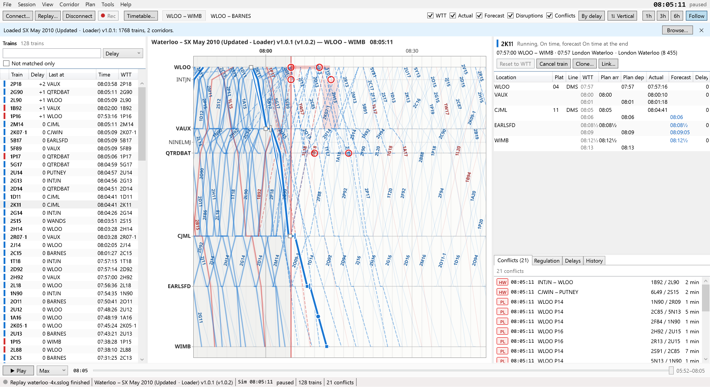

# Stringline user guide

Stringline draws a live train graph (time against distance) for a running [SimSig](https://www.simsig.co.uk/) simulation, and helps you re-plan late services around delays and disruptions, in the style of an Electronic Train Graph. It reads the sim through SimSig's Interface Gateway. It only reads, unless you turn on [assist](assist.md) to send a route request or interpose a description, one confirmed command at a time.

In the app, **Help ▸ User guide** opens this guide, and **F1** opens the page for the panel or window you are in. Both work without a network.

## Contents

**Getting going**

1. [Installing](installing.md)
2. [Turning on the Interface Gateway](gateway.md)
3. [Connecting](connecting.md): single player, payware sims and multiplayer
4. [Timetables and profiles](timetables-and-profiles.md)
5. [Signal places and sharing a profile](signal-places.md)

**Using the graph**

6. [Reading the graph](reading-the-graph.md): the lines, moving around, and boards (split view and board windows)
7. [Re-planning](re-planning.md): grips, nudges, the right-click menu and undo
8. [Disruptions and notes](disruptions-and-notes.md)
9. [Conflicts and suggestions](conflicts-and-suggestions.md)
10. [The regulation list](regulation.md)
11. [Assist](assist.md): route requests and interposing, off unless you turn it on

**Keeping your work**

12. [Sessions, recordings and review](sessions-and-review.md)
13. [Exports and reports](exports-and-reports.md): pictures, PDFs, multi-page plots and CSV

**Reference**

14. [Settings](settings.md)
15. [Troubleshooting and logs](troubleshooting.md)
16. [Glossary](glossary.md)
17. [Keyboard and mouse](keyboard-and-mouse.md)
18. [Further reading](further-reading.md)
19. [Privacy](privacy.md): what Stringline stores, what it sends, and how to remove it

## Five-minute start

1. In SimSig, tick **Interface Gateway** in the options when you start the sim ([how](gateway.md)).
2. In Stringline, choose **Session ▸ Connect to SimSig…** (F5) and press **Connect**.
3. When the sim's name arrives, pick its timetable in the bar above the graph and press **Load**.
4. Watch the trains run. Hover over anything to see what it is; click a train to select it.
5. To re-plan a late train, select it and drag one of its square grips ([how](re-planning.md)).

No sim to hand? Choose **Session ▸ Open replay…** (Ctrl+O) and play a recording. The source code's `tests/fixtures` folder has `waterloo-4x.sslog` with `waterloo 2010.WTT` to try.

## About this guide

The guide is kept with Stringline's source, in `docs/user-guide`, and copied to the project's [wiki](https://github.com/frddunc-glitch/Stringline/wiki). Corrections are welcome on the [issue tracker](https://github.com/frddunc-glitch/Stringline/issues). Railway words are used as SimSig uses them: the [glossary](glossary.md) explains them.
