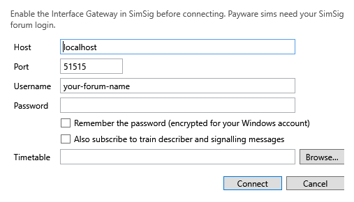

# Connecting

## Single player

1. Start the sim with the [Interface Gateway turned on](gateway.md).
2. In Stringline, choose **Session ▸ Connect to SimSig…** (F5), or **Connect…** on the toolbar.
3. Check the details:
   - **Host:** `localhost` when SimSig runs on the same computer; otherwise the name or IP address of the computer running it.
   - **Port:** 51515, unless you changed it in SimSig.
   - **Timetable:** optional. Pick the sim's `.wtt` here, or leave it blank and pick it when the sim's name arrives ([Timetables and profiles](timetables-and-profiles.md#loading-the-timetable)).
4. Press **Connect**.

The light at the left of the status bar turns green, and the status bar shows the sim's name, the sim time and speed, and how many trains have been seen. Stringline remembers the details for next time.

## Payware sims

Enter your **SimSig forum username** and **password**: SimSig checks them online before it lets Stringline in, which can take a few seconds.

- The username is always remembered.
- Tick **Remember the password (encrypted for your Windows account)** to keep the password too. It is encrypted so that only your Windows account can read it.
- Stringline never writes your password to its logs, recordings or sessions.

If SimSig does not accept the login, the status bar says **SimSig refused the connection**, and Stringline does not try again, so that the forum login is not hammered. Correct the details and connect again.

## Train describer and signalling

**Also subscribe to train describer and signalling messages** adds SimSig's train describer and signalling feed. Stringline does not need it for the graph. Tick it only if you are making a [recording](sessions-and-review.md#recording) for someone who wants those messages: it is much busier.

## When the connection drops

If the sim is closed or crashes, or the network drops, the status bar shows **Disconnected — retrying in *n* s** and Stringline keeps trying, waiting a little longer between tries (up to 30 seconds). It picks up as soon as the sim is back. The graph, your plan and the session are kept meanwhile.

**Session ▸ Disconnect** ends the session: the session is saved and closed (see [Sessions](sessions-and-review.md)).

## Multiplayer (provisional)

> This section is provisional. How the gateway behaves in a multiplayer game has not yet been tested with Stringline; it will be confirmed after a recording of a multiplayer session has been studied.

What is known so far:

- Stringline connects to **one** gateway: the host name (or IP address) and port of a computer whose SimSig is running the sim with the Interface Gateway turned on. In a multiplayer game that is most likely the **host's** computer; whether a client's SimSig runs a gateway of its own is not yet known.
- To connect from another computer, enter the host computer's name or IP address in **Host**, and make sure its firewall lets port 51515 through ([Firewalls](gateway.md#firewalls)).
- It is not yet known whether a player sees the whole sim's trains through the gateway, or only those on their own panel. Trains running on another player's area may not report to you.
- Stringline only reads. It cannot interfere with the other players' game.

If you try multiplayer, please say how it went on the [issue tracker](https://github.com/frddunc-glitch/Stringline/issues).

## Without a sim: replays

**Session ▸ Open replay…** (Ctrl+O) plays a recording (`.sslog`) as if it were live, with a transport bar to pause, change speed and seek. See [Replaying a recording](sessions-and-review.md#replaying-a-recording).
