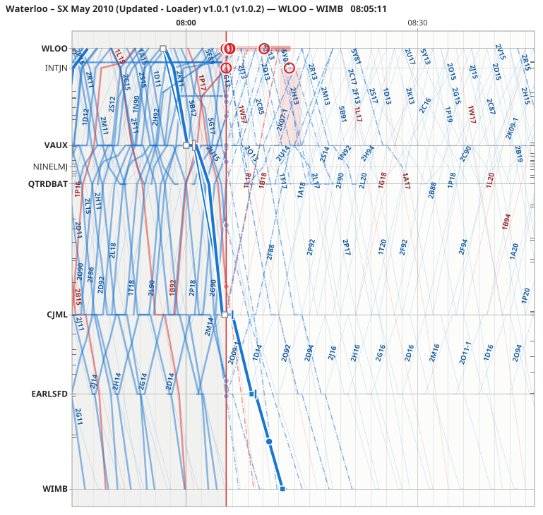

# Re-planning

Stringline keeps a **working plan**: the WTT, with the changes you make to it. You re-plan a train to see where it will run and what it will clash with: holding it, retiming it, changing its platform, cancelling it and so on. The plan is yours alone. Stringline does not send it to SimSig; you signal the trains to it yourself (or, with [assist](assist.md) on, ask SimSig for a route from the train's menu).

Every change is one **edit**, which can be undone, and every edit is kept in the [session](sessions-and-review.md).

## Selecting a train

Click a train's line on the graph, or its row in the train list, the Delays tab or a conflict. The train is drawn thick with a halo, the others dim, and the [train detail panel](#the-train-detail-panel) shows its timings. Click the background, or press Esc, to clear the selection.

## Grips

The selected train shows **grips** on its line: handles that you drag to re-plan it.

| Grip | Where | Drag it to |
|---|---|---|
| **Square** | At each timing point | Retime the train from that point onwards. |
| **Bar** | Across the line at the end of each stop | Make the stop longer or shorter (the dwell). |
| **Round handle** | On the line, in the part of the run still to come | Retime the whole of the rest of the run. Dragging the line itself does the same. |

- The grips are on the train's plan line if you have re-planned it, else on its WTT line. With the WTT layer hidden, a train not yet re-planned has no grips.
- Hover over a grip to see what it does: the cursor changes, the status bar names the action, and the tooltip explains it.
- **Hollow grey** grips cannot move: a point the train has already passed, the arrival at a platform it is standing at (drag its departure bar instead), or a cancelled or finished train. The tooltip says why.

While you drag, a ghost of the new plan follows the mouse, and a label at the grip gives the new time and the change, for example `07:15:30 (+3 min)`. Times snap to 15 seconds; hold Shift for 1 second. Release to make the edit; press Esc to drop the drag.

A drag stops at a limit, and the grip and its label turn red and say which: **now** (nothing is planned in the past), the train's **last report**, its **minimum run** time (a train cannot run faster than the WTT's quickest timing, slowed by any speed restriction), or its **arrival** (for a dwell).

Alt+drag from any point on the selected train's line retimes it from there, as the square grips do.

## Nudging with the keys

Click a grip (without dragging) to pick it: it gets a blue ring. Then press the arrow keys along the time axis (← and → on a horizontal graph, ↑ and ↓ on a vertical one) to move it by 15 seconds, or by a minute with Shift. Each nudge is one edit, with the same limits as a drag.

## The right-click menu

Right-click a train's line for its menu, at the timing point nearest the click. It selects the train too. What it offers depends on the train and the point:

| Item | Does |
|---|---|
| **Hold here…** | Sets a departure time here. At a pass, it adds a stop. |
| **Add stop…** | Adds a stop at a point the train passes. |
| **Skip stop** | Runs through a stop without calling. |
| **Change platform…**, **Change line…** | Changes the platform or line at this point. |
| **Terminate here** | Ends the train's run here (the rest is drawn grey in the detail panel). |
| **Cancel train**, **Reinstate** | Cancels the train, or brings it back. |
| **Run anyway**, **Leave to start rules** | For a train SimSig will [not run](timetables-and-profiles.md#trains-that-will-not-run) this session: forecast it anyway, or take that back. |
| **Reset to WTT** | Throws away every change to this train. |
| **Clone as ad-hoc…** | Copies the train as an extra train with a new headcode, a number of minutes later. The copy is selected so you can drag it into place. |
| **Link to WTT train…**, **Match automatically** | For a live train: links it by hand to a WTT train (or to none), or goes back to automatic matching. |
| **Regulation list at…** | Opens the [regulation list](regulation.md) at this location. |

Right-click the background for [disruptions and notes](disruptions-and-notes.md). The **Plan** menu has the commands for the selected train too.

## The train detail panel

The panel at the top right shows the selected train: its headcode, state (running and how late, not started, finished, not running, cancelled, terminated short, re-planned), its route, and buttons for **Reset to WTT**, **Cancel train** (or **Reinstate**), **Run anyway** (for a train that will [not run](timetables-and-profiles.md#trains-that-will-not-run)), **Clone…** and, for a live train, **Link…**. The state also says when a [timetable rule](conflicts-and-suggestions.md#timetable-rules-in-the-forecast) holds the train ("held by rule: after 2Y28 leaves (+25 min), until 09:12"), and lists the rules that choose between it and another train ("rule: does not run if 2Y01 runs").

Below is its schedule, one row per timing point:

| Column | Shows |
|---|---|
| Location | The timing point (hover for its TIPLOC) |
| Plat, Line | Platform and line; bold where you changed them |
| WTT | The booked times |
| Plan arr, Plan dep | The working plan's times; bold where you changed them |
| Actual | When the train got there |
| Forecast | When it is expected (blue) |
| Delay | Minutes late (`+3`) or early (`−1`); hover for it in words |

A stop shows its arrival above its departure. Passes are in italics; points after a short termination are grey.

**Editing in the table.** Double-click a cell in Plat, Line, Plan arr or Plan dep to change it. A new arrival time retimes the train from there; a new departure at a stop sets the dwell. Type times as `07:30`, `07:30:15` or `7:30`; a time near midnight takes the nearer day.

## Undo and the edit history

**Plan ▸ Undo** (Ctrl+Z) and **Redo** (Ctrl+Y or Ctrl+Shift+Z) undo and redo edits; the menu names the edit. The **History** tab lists every edit in the session, oldest first: undone edits are grey, and ⚠ marks an edit that hit a limit (hover for what happened). Its ↶ Undo and ↷ Redo buttons do the same as the menu.

Undo and redo cover every kind of edit, including [disruptions and notes](disruptions-and-notes.md) and applied [suggestions](conflicts-and-suggestions.md#suggestions).
