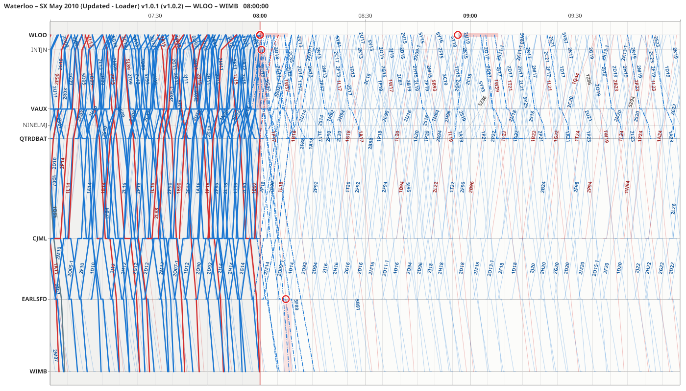
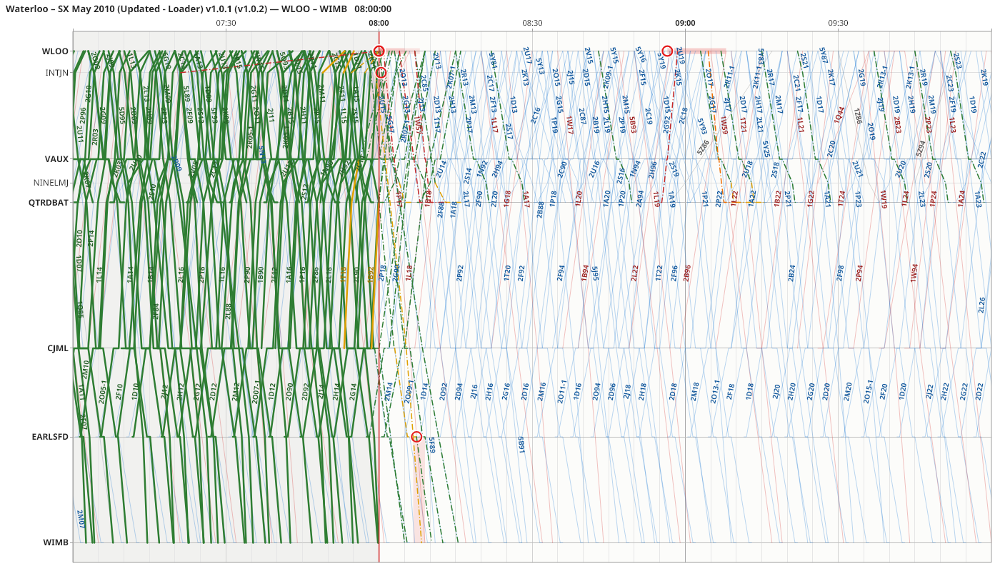

# Reading the graph

## The main window

From left to right: the **train list**, the **graph**, and the **side panel** (the selected train's detail above, with the Conflicts, Regulation, Delays and History tabs below). Above them are the menus, the sim clock (top right), and the toolbar with the corridor tabs. The status bar is at the bottom; while a replay plays, its transport bar is just above it.

Drag the grey splitters between the panels to resize them; double-click one to hide or show the panel beside it. See [Window layout](settings.md#window-layout).

## Time and distance

Time runs across the graph, left to right, and the corridor's locations run down its left edge, with the corridor's **Up end at the top**. A train's line slopes down to the right when it runs Down, and up to the right when it runs Up. A level stretch is a stop: the train is standing at that location. The steeper the line, the faster the train.

**View ▸ Vertical** (or **⇅ Vertical** on the toolbar) turns the graph so time runs down the page, with the locations across the top, as on a train control diagram.

Each **corridor** is a tab above the graph: click one, use the **Corridor** menu, or press Ctrl+1 to Ctrl+9. Tabs that do not fit are listed under **»**. See [Profiles and corridors](timetables-and-profiles.md#profiles-and-corridors).

The location names are on the left, bold for stations with platforms. A long name is shortened with "…"; hover over it for the whole name, its TIPLOC and its platforms. The profile editor can give it a shorter name for good.

## Lines on the graph

| What you see | What it is |
|---|---|
| Thin, faint line | The **WTT**: the train as booked. |
| Medium solid line | The **working plan**, where you have re-planned a train away from the WTT. |
| Heavy solid line | The **actual** running, as the sim reported it. |
| Dash-dot line (– · – ·) | The **forecast**: where a running train is expected to go from here, and a train not yet started if it is expected a minute or more off its plan. |
| Short heavy line ending in a dot, at now | The **live head**: a running train's line carried on from where it was last reported to now, along its forecast. See [Between timing points](#between-timing-points). |
| Faint dotted row | A **minor row**: a timing location you added to the corridor as minor in the profile. Its name shows when you zoom in. |
| Thin grey line with crosses at the ends | A **cancelled** train. |
| Very faint line | A train SimSig will **not run** this session (see [Trains that will not run](timetables-and-profiles.md#trains-that-will-not-run)). **View ▸ Show not-running trains** hides them. |
| Grey heavy line | A live train not matched to the timetable. |
| Thick line with a halo | The **selected** train. Other trains are dimmed. |
| Red vertical line | **Now**. The past is lightly shaded. |
| Red ring and red band | A [conflict](conflicts-and-suggestions.md). |
| Red hatched box | A [block or possession](disruptions-and-notes.md). |
| Amber band | A [speed restriction](disruptions-and-notes.md). |
| Small ring with a yellow label | A [note](disruptions-and-notes.md#notes). |

Each train is drawn in its category's colour, and some categories may be dashed or dotted. A category is never dash-dot, so a dash-dot line is always a forecast. The headcode is written along the line.

The toolbar's **WTT**, **Actual**, **Forecast**, **Disruptions** and **Conflicts** boxes (also in the View menu) show and hide those layers. **View ▸ Show live head** shows and hides the live heads.

### Between timing points

On a sim with few timing points, a train can go several minutes between reports. Stringline shows its progress in between in three ways:

- **Timing locations the timetable leaves out.** SimSig reports some timing locations that a train's own schedule does not list. The actual line bends there, and the forecast carries on from the latest one, so a train that has made up time is shown on time sooner. Hovering there says the WTT is "not booked", and the forecast says "Passed EARLSFD 09:12 (not booked)". There is no delay at such a place, so the line keeps the colour of the last delay known.
- **Signals.** Once Stringline has learned where the signals are on a sim (see [Signal places](signal-places.md)), the actual line bends at each signal the train passed, and the forecast carries on from the last one, or from the track circuit or train describer berth the train has reached since. Hover a bend to see when the train passed the signal and what it showed ("passed S457 at 09:12:30 (green)").
- **The live head.** Each running train's line goes on from its last report to now, ending in a dot that moves with the clock. It follows the forecast, but stops just short of the next timing point until the train reports it there, so it never shows a train further on than it is known to be. The live head is off while reviewing a session, and in pictures made with `render-png` unless you add `--live-head`; **View ▸ Show live head** turns it on or off.
- **Standing at a signal.** When the signal ahead of a train is at red and the train is overdue there, Stringline shows it standing at that signal rather than running late: its live head stops at the signal and stays there, its forecast waits there and then carries on, and the hover says "Standing at S28 since 07:58". It needs the signals learned, and works best with the TD topic (SimSig sends signal aspects only with it); without it, a train that passed a single yellow and is overdue at the next signal counts as standing. The train detail says "standing at S28 since 07:58" too.
- **Signals on the axis.** **View ▸ Signals** shows the learned signals as short **ticks** on the edges of the graph (the default: Down signals on the location names' side, Up signals on the other), as faint **rows** across it, or not at all. Hover a tick or row for the signal's name and where it was learned.
- **Minor rows.** If a timing location you want to follow is not on the corridor, add it in the profile editor and tick **Minor** (see [Profiles](timetables-and-profiles.md)). It draws as a faint dotted row, without a grid line, and its name shows only when you zoom in.

### Colour by delay

**By delay** on the toolbar (View ▸ Colour by delay) colours the actual and forecast lines by how late the train is at each timing point, instead of by category:

| Colour | Meaning |
|---|---|
| Green | On time (within the minute) or early |
| Amber | 1–5 min late |
| Orange | 6–15 min late |
| Red | More than 15 min late |

Lateness is always said as the railway says it: "On time", "3 min late" or "1 min early". The lists show it as signed minutes (`+3`, `0`, `−1`) so that they fit and sort; hover over one to have it in words.

## Moving around

| To | Do |
|---|---|
| Zoom in or out in time | Mouse wheel, about the mouse |
| Zoom along the corridor | Ctrl + mouse wheel |
| Pan in time | Shift + mouse wheel, or drag the background |
| Show 1, 3 or 6 hours across | **1h**, **3h**, **6h** on the toolbar, or the View menu |
| Show the whole corridor | **Corridor ▸ Whole corridor** |
| Keep the now line in view | **Follow** on the toolbar, or Space with the graph focused |

Panning in time stops the graph following now; press **Follow** (or Space) to go back.

## Boards: split view and board windows

You can watch more than one corridor at once. Each graph is a **board**, with its own corridor, and all boards keep the **same time**: panning, zooming, the 1h/3h/6h buttons and **Follow** on any board move them all, while each keeps its own zoom along its corridor.

- **View ▸ Split view ▸ One above the other** or **Side by side** puts a second board in the main window, with a splitter between the two. Pick its corridor in the box above it. **✕** (or **View ▸ Split view ▸ Off**) closes it; it comes back with the same corridor.
- **View ▸ New board window** opens a board in a window of its own, for example on a second monitor. Open as many as you like; **View ▸ Close board windows** closes them all.
- Every board works like the main graph: hover, click to select (the selection is the same on every board), drag [grips](re-planning.md#grips), right-click menus and B+drag. A train being dragged, or a suggestion being previewed, shows its ghost on every board whose corridor it runs on.
- The board you used last is the one that **File ▸ Export** and **Corridor ▸ Whole corridor** act on. Ctrl+Z, Ctrl+Y, Ctrl+E and Ctrl+P work in board windows too.
- Stringline remembers the split view and the board windows (their corridors and places) and opens them again at the next start. **View ▸ Reset layout** gives the two halves of the split view equal room.

## Hovering

Hover over anything for its details:

- **A train:** its headcode and description, the location, its booked, planned, actual and forecast times there, and whether it is early, on time or late. Knock-on delay from other trains, a hold by a [timetable rule](conflicts-and-suggestions.md#timetable-rules-in-the-forecast) and "possibly stopped" (no report for a while) are shown when they apply.
- **A conflict ring or band:** what clashes, which trains, where and when, the delay needed to clear it, the headway used, and the best suggestion. See [Conflicts](conflicts-and-suggestions.md).
- **A block or speed restriction:** its section, tracks, times and effect, and its note.
- **A location name:** its whole name, TIPLOC and platforms.
- **A grip** on the selected train: what dragging it does, or why it cannot move. See [Grips](re-planning.md#grips).

## The train list

The list on the left has one row for each train seen in the sim: its colour, headcode, **Delay** (in minutes, at its latest booked point), where it was **Last at** and when, and its **WTT** match.

- **Sort** by delay (the default, the latest-running trains first), headcode or last report.
- **Filter** by typing part of a headcode, location or train.
- **Not matched only** lists the trains not matched to the timetable (in grey italics).
- Click a row to select the train on the graph; double-click to centre the graph on its last report.
- Under **Not running**, after the trains in the sim, are the timetable's trains that SimSig will not run this session, with the reason in **Last at** and their booked start in **Time**. See [Trains that will not run](timetables-and-profiles.md#trains-that-will-not-run).

## The status bar and sim clock

The **sim clock** is at the top right, with the sim's speed. [Tools ▸ Options ▸ Display](settings.md#display) makes it Large or Huge.

The status bar shows, left to right: the connection (green when connected), the sim and timetable, the sim time and speed, the number of trains (and how many are not matched), the number of conflicts, and what the last edit or drag did. "Recording" shows at the right while you [record](sessions-and-review.md#recording).
