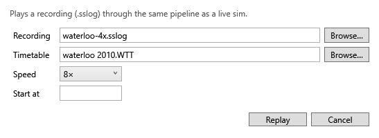

# Sessions, recordings and review

## Saved sessions

Every connection and every replay is a **session**, and Stringline saves it as you go (every couple of seconds and when you close the app) to `Documents\Stringline\sessions`. A session holds the timetable used, the sim's reports (for a live session) or where the replay had got to, and every edit you made, including undone ones. The file is made once there is something worth keeping: the first report from the sim, or a replay's first edit.

A session **ends** when you choose **Session ▸ Disconnect** or start another session. Closing Stringline (or a crash) leaves it **running**, ready to resume.

Old sessions can be deleted automatically: see [Logging and housekeeping](settings.md#logging-and-housekeeping).

## Resuming

If the last session was left running, Stringline offers to resume it when it starts: the bar above the graph names it, with **Resume** and **Review** buttons. **File ▸ Resume saved session…** opens any session.

- **A live session** is rebuilt as it was, with your plan; the clock stands at the last report. Connect to the sim again, and Stringline asks whether to **Carry on** with the same session or **Start a new session**.
- **A replay session** opens its recording again, paused where it got to, with your plan.

If the timetable or recording has moved, Stringline asks where it is.

## Review

**File ▸ Review saved session…** plays a session back from its start, read-only, with the transport bar. As the clock passes each edit, the plan shows it, as it was at that moment, so seeking back takes edits away again. You cannot make edits in review; the title ends "(review)". Starting any other session leaves review.

## Recording

**Session ▸ Record to file**, or **Rec** on the toolbar, records the live connection to a `.sslog` file in `Documents\Stringline\recordings`, named after the sim and the time. Press it again to stop. The status bar says "Recording" meanwhile.

A recording holds the gateway's messages only: never your login. It is useful for replaying a session later, sharing one for a bug report, or trying things out without the sim.

## Replaying a recording

**Session ▸ Open replay…** (Ctrl+O), or **Replay…** on the toolbar, plays a recording as if it were live.



| Box | What to enter |
|---|---|
| Recording | The `.sslog` file |
| Timetable | The sim's `.wtt` (optional; as when connecting) |
| Speed | 1×, 2×, 4×, 8×, 16×, 30×, 60× or Max |
| Start at | A sim time to start from (optional): everything before it is played at once |

While it plays, a **transport bar** above the status bar has **Play/Pause**, the speed, the replay's time, and a seek bar. Drag the seek bar to jump to another time. Once a replay has finished, seeking plays it again from the time you pick, keeping your plan.

Everything works in a replay as it does live: re-planning, conflicts, exports and the session.

## Starting from the command line

`Stringline.exe` can open a timetable, a replay or a saved session as it starts, for a shortcut or a script:

```
Stringline.exe [--wtt t.wtt] [--replay x.sslog [--speed 8|max] [--start 07:30]] [--resume s.stringline | --review s.stringline]
```

- `--wtt` loads a timetable.
- `--replay` plays a recording, at `--speed` (or `max`, as fast as it can) and from `--start`.
- `--resume` carries on a saved session; `--review` opens one to look at.
