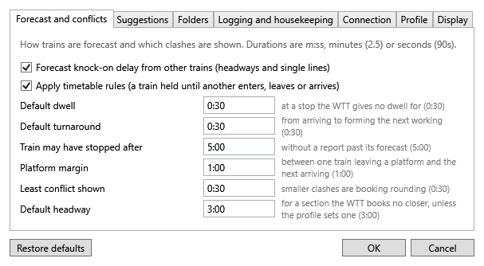

# Settings

**Tools ▸ Options…** (Ctrl+,) has Stringline's settings, in five tabs. Durations can be typed as `m:ss` (`2:30`), minutes (`2.5`) or seconds (`90s`). **OK** checks them all and keeps the window open, with the reason, until they pass; **Cancel** changes nothing; **Restore defaults** puts every box back as it came.

## Forecast and conflicts

| Setting | Default | What it does |
|---|---|---|
| Forecast knock-on delay from other trains | On | Holds trains in the forecast behind late ones (the same switch as the Plan menu). See [Knock-on](conflicts-and-suggestions.md#knock-on-in-the-forecast). |
| Default dwell | 0:30 | How long a train stands at a stop the WTT gives no dwell for. |
| Default turnaround | 0:30 | The least time from a train arriving to it leaving again as its next working. |
| Train may have stopped after | 5:00 | How long past its forecast a train can go without a report before it is marked "possibly stopped". |
| Platform margin | 1:00 | The least time between one train leaving a platform and the next arriving in it. |
| Least conflict shown | 0:30 | Smaller clashes are not listed: they are only the timetable's rounding. |
| Default headway | 3:00 | The headway for a section with none of its own. See [Headways](timetables-and-profiles.md#headways). |

## Suggestions

Whether suggestions may terminate a train short or cancel it for a block (the same switch as **Allow cancelling** on the Conflicts tab), and what each kind of change costs when the [suggestions](conflicts-and-suggestions.md#suggestions) are ranked, in minutes of weighted delay: a platform change (2), a line change (2), terminating short (30) and cancelling (60). A higher cost makes that kind of suggestion rarer.

For [Plan ▸ Re-plan](conflicts-and-suggestions.md#re-planning-the-next-hour):

| Setting | Default | What it does |
|---|---|---|
| Re-plan with the optimiser, or with the suggestion rules | the optimiser | The optimiser weighs every conflict at once; the rules take one conflict at a time, the earliest first, and apply its best suggestion. |
| Let a re-plan move trains to other platforms | on | Each move costs the platform change penalty above. |
| Re-plan ahead | 60 min | How far ahead of the sim's time to clear conflicts. |
| Re-plan time limit | 5 s | How long it may think; the best plan found by then is used. |

## Folders

Where Stringline looks for timetables (SimSig's Timetables folder unless you change it), and where it puts saved sessions, recordings and exports. Leave a box blank to use the folder shown under it.

## Logging and housekeeping

- **Detailed logging (Debug)**: more detail in the logs, for chasing a problem. See [Logs](troubleshooting.md#logs).
- **Keep logs for** a number of days (14 unless you change it), from the next start.
- **Open log folder**.
- **Delete saved sessions last saved more than** a number of days ago: off unless you turn it on. Old sessions are deleted when Stringline starts, but never the newest one, so it can still be resumed. Turning it on asks before deleting any.

## Display

**Sim clock size**: Normal, Large or Huge. Large or Huge can be read from across the room.

## Other settings that are remembered

Stringline remembers, without being asked:

- the connection details (and the password, if you ticked the box) and the timetable for each sim;
- the graph's layers, colouring and orientation (View menu), and the corridor shown;
- the [window layout](#window-layout).

## Window layout

- **Resize panels** by dragging the grey splitters between them. The graph gets most of the extra room when the window grows; each panel has a least size.
- **Hide a panel** by double-clicking the splitter beside it (the one under the train detail hides the tabs), or with **View ▸ Panels**. Double-click again to bring it back.
- **View ▸ Reset layout** shows every panel at its first size.

The window's size and place, and the panels' sizes, are kept for next time. If the screen the window was on has gone, it opens on the main screen.
