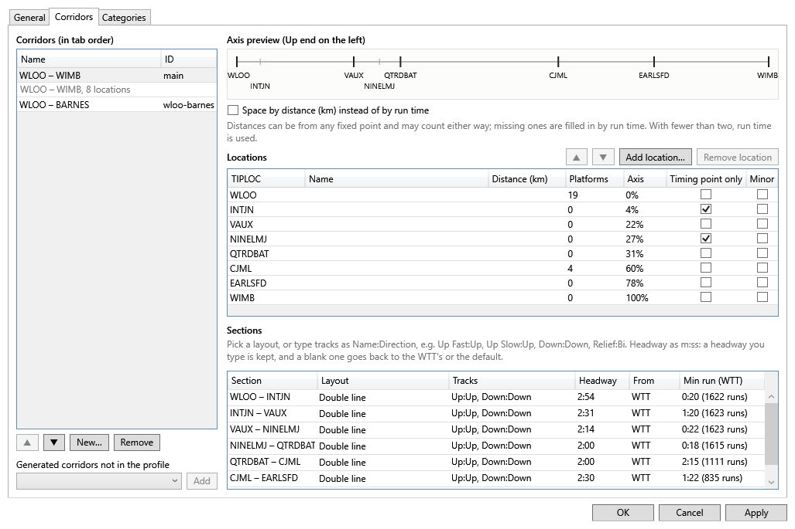

# Timetables and profiles

Stringline draws the graph from two things: the sim's **working timetable** (WTT, a SimSig `.wtt` file) and a **profile** for the sim, which says which lines (corridors) to draw and how.

## Loading the timetable

There are three ways:

- **Pick it in the Connect or Replay dialog.** Stringline remembers the timetable you used for each sim.
- **Wait for the sim's name.** When the sim's name arrives over the gateway and no timetable is loaded, the bar above the graph offers the timetable you last used for that sim, and every timetable for that sim in SimSig's Timetables folder (`C:\Users\Public\Documents\SimSig\Timetables`). Pick one and press **Load**, or **Browse…** for another.
- **File ▸ Load timetable…** (Ctrl+T), or **Timetable…** on the toolbar, at any time. Loading one in the middle of a session matches the trains seen so far against it again.

A timetable for a different sim gets a warning, with suggestions for the right one.

**File ▸ Timetable import warnings** lists anything in the WTT that Stringline could not use (an unknown location, say). The trains it could read are still drawn.

### Matching live trains to the timetable

Each train in the sim is matched to its train in the WTT by its headcode and where and when it runs. A train that cannot be matched (an extra train added in the sim, say) is drawn in grey and shown in italics in the train list. To match it by hand, select it and choose **Plan ▸ Link selected live train to WTT train…** (or **Link…** in the train detail panel). See [Re-planning](re-planning.md#the-right-click-menu).

### Trains that will not run

When you start a sim at a time other than the timetable's start (14:00 on Penrith, say), SimSig does not run every train in the timetable. It leaves out:

- trains that are not seeded and were booked to come in before the start: SimSig starts their **seeded** copies instead, already part-way through their run;
- trains seeded for another start time (another *seed group* in SimSig's Loader);
- trains formed from one of those (the next working of a train that never came in).

Stringline works these out from the timetable and the time the sim started, and shows them as **Not running**: faint on the graph, in their own group at the foot of the train list, and counted apart in the Delays tab. They are not forecast, and make no conflicts or suggestions. The train detail says why ("seed group 04:00", "not seeded", "formed from 186K"). This is not an edit, so you do not need to cancel them.

If you connect to a sim that has been running for a while (or load a saved game), Stringline cannot tell when it started, so it leaves out only trains seeded for another start time.

If Stringline is wrong about a train, select it and press **Run anyway** in the train detail panel (or right-click it on the graph, or **Plan ▸ Run selected train anyway**). That is an edit: it can be undone, and it is saved with the session. A train that turns up in the sim always runs, whatever Stringline thought.

A seeded train that has not been seen two minutes after the start is marked "not seen since the start" in its detail and hover. It may have been removed in the sim. It is still forecast.

## Profiles and corridors

The first time you load a sim's timetable, Stringline works out its **corridors**: the routes through the sim that each make one graph, with their locations in order along them. Each corridor is a tab above the graph. The profile also holds:

- **display names** for locations (handy for a long name the graph has to shorten);
- **distances** between locations, if you want the graph spaced by distance rather than evenly;
- **sections** between locations: their tracks (for example "Down, Up", or a single line) and their **headways**;
- **categories** of train, with a colour and line style each.

The profile is saved in `%APPDATA%\Stringline\profiles` under the sim's name, and Stringline keeps it up to date as you load timetables. Your own changes are kept.

## The profile editor

**Tools ▸ Edit profile…** opens the editor. Changes are made to a draft: **Apply** saves them and redraws the graph (your plan and selection are kept), **OK** applies and closes, **Cancel** throws them away (after asking). A change that cannot be made (a location that is not on the corridor, say) is refused, with the reason under the tabs.

**General**

- The sim's ID (from the timetable or the gateway; you can type one only when neither gives it) and its name. Leave the name blank to show the sim's ID, tidied (`waterloo` → Waterloo). A name you type is always shown. An older profile that took a timetable's title as its name shows the sim's ID instead, whichever of that sim's timetables you load.
- Every location's **display name**, with the corridors it is on. **Import names from CSV…** reads a list of TIPLOCs and names.
- The profile's **Default headway**: see [Headways](#headways).

**Corridors**

- The corridors in tab order. Rename one in place, move it with ▲ and ▼, make a **New…** one from two ends, **Remove** one, or **Add** a generated corridor that is not yet in the profile.
- For the selected corridor: a preview of its axis (its Up end on the left), **Space by distance**, its locations (name, distance, platforms, **Minor**; **Add location…** after the one selected, **Remove**, ▲ and ▼), and its sections:
  - **Minor** makes a location a faint row on the graph, with no grid line and its name only when zoomed in. Use it for a timing location the corridor left out, so trains reporting it show their progress there. A location added between two others splits their section, and both halves keep its tracks (a single line stays single);
  - **Tracks**, as a layout or as text;
  - **Headway**, as minutes and seconds (`2:30`);
  - **From**: where the headway comes from (Hand, WTT or Default). Its tooltip explains it;
  - the WTT's least running time through the section.

**Categories**

Each category's name, colour (`#RRGGBB`), line style (solid, dashed or dotted; forecasts are always dash-dot, so they are never mistaken for a category), priority and number of trains. The graph draws each train in its category's colour.

### The other profile commands

In the **Tools** menu:

- **Open profile file** opens the profile's JSON file in the program Windows uses for JSON, for hand editing.
- **Reload profile** reads it again after a hand edit and redraws. A damaged file is reported, and the profile in use is kept.
- **Regenerate corridors…** works the corridors out afresh from the timetable. If you have changed any by hand, it asks first: **Replace all**, **Keep mine** (beside the new ones), or **Cancel**.

## Headways

A **headway** is the least time between two trains following each other on the same track through a section. Stringline uses it to find [headway conflicts](conflicts-and-suggestions.md#kinds-of-conflict), and in the forecast to hold a train behind the one in front. SimSig itself works by signalling, not headways, so Stringline works one out for each section, in this order:

1. **Hand:** a headway you typed in the profile editor. It is always kept.
2. **WTT:** what the timetable books. Where the WTT books trains closer together than the default (5% of the booked pairs of trains closer, from at least ten pairs), its figure is used. A WTT figure is used only to make a headway shorter, never longer.
3. **Default:** the profile's default headway if it has one, else the one in [Tools ▸ Options ▸ Forecast and conflicts](settings.md#forecast-and-conflicts) (3 minutes unless you change it).

Clear a headway in the editor to go back to the automatic one. The conflict tooltip says which headway it used and where it came from.

If you know a section's signalling lets trains run closer than Stringline thinks, or needs more room, type its headway in the editor.
